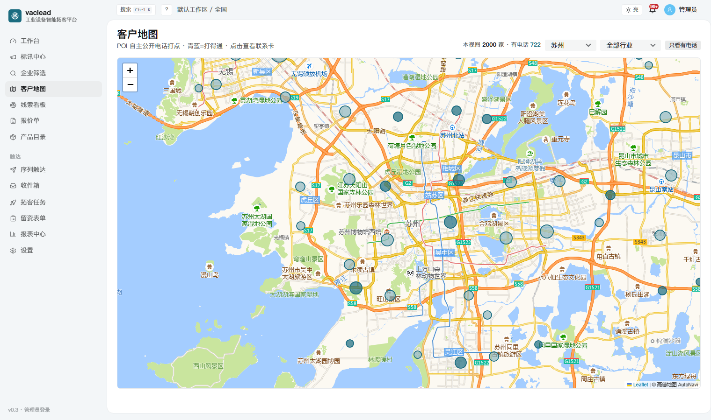
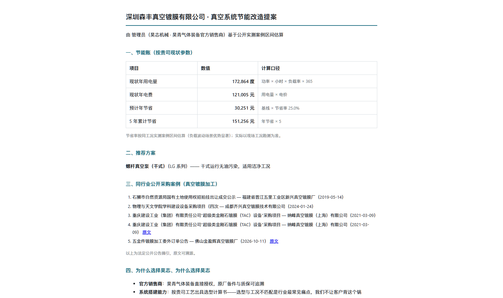
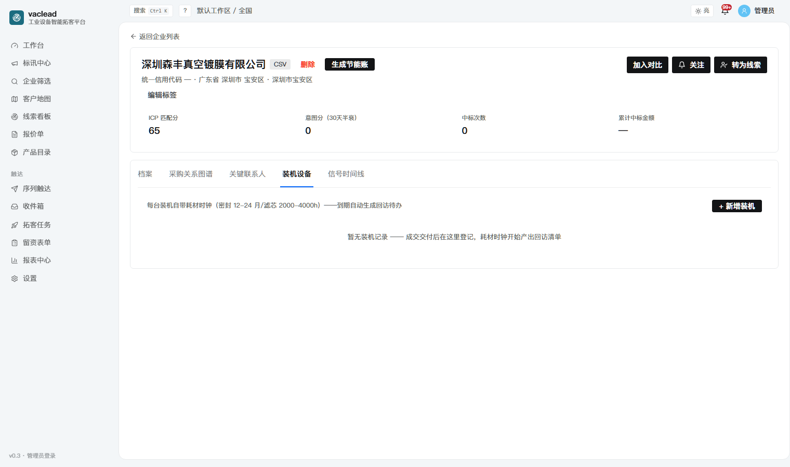
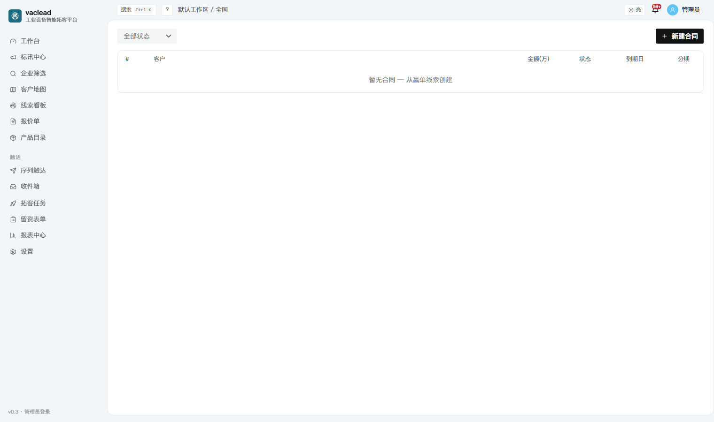
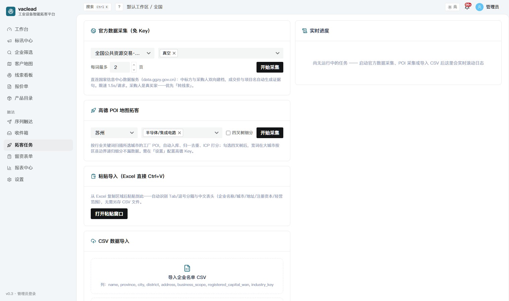

# vaclead · 工业设备智能拓客平台

> 从**官方公示数据**到**可拨打线索**到**商机成交**的全链路自托管销售平台。
> 单进程 · 零外部服务依赖 · SQLite 即真源 · MIT 开源。

一个面向**工业设备全行业**销售团队（代理商/集成商/厂商直销均适用）的智能客户获取与经营平台（真空/半导体/机床/化工/食品包装/环保/医疗/自动化等 20 类买家行业，词表配置驱动可增删）。它不依赖任何付费数据 API——直接从国家公共资源交易平台、中国政府采购网、地图商户公开信息等**官方与公开渠道**中挖出「谁在买设备、买了什么、花了多少钱、找谁谈、现在就打这个电话」。

```
官方数据采集 → 信号引擎(词表匹配) → 双向建档(中标方+采购人) → 标讯中心/订阅
     → 12 维筛选 + 客户地图 → 智能推荐(先打给谁) → 触达快标 → 线索管线
     → 报价单 → 合同回款守护 → 装机台账(耗材时钟复购) → 分析周报 → Agent 接口
```

## 界面速览

**工作台**——每日打开 10 分钟：KPI 环比（含流失预警）、**今日推荐·先打给谁**（可解释排序+一键转线索）、信号趋势、跟进健康度、加权预测、今日作战清单


**客户地图**——POI 自主公开电话打点：青蓝聚合圆=打得通的地盘，圆越大客户越密；点击下钻城市看全量



**标讯中心**——中标/采购/政采公告三类信号流：多维筛选带命中计数，每条带金额与溯源证据句，拟建备案/招标中/竞对动态三视角，一键订阅/转线索


**企业情报页**——工商档案 + ICP 四段可解释评分 + 采购关系图谱 + 关键联系人（触达结果标记）+ **装机设备台账**（耗材时钟自动生成回访待办）+ **生成节能账**（一键打印客户提案）


**客户提案**——输入客户现有泵参数，自动生成节能账（年省/5 年/回收期）+ 选型推荐 + 同行业公开采购案例，浏览器直接另存 PDF



**企业筛选**——12 维组合筛选 + 触达覆盖（未触达/已触达）+ 客户角色（OEM 设备商）+ 快捷筛选 + 汇总条 + 批量操作


**线索看板**——拖拽转阶段（赢率自动更新）+ 日历视图 + 公海流转 + 批量领取


**报表中心**——经营周报（KPI 环比/漏斗/Top 标讯/来源转化对比）+ CSV 导出 + 每周一邮件摘要


<details>
<summary>更多界面（装机设备 / 合同管理 / 企业对比 / 任务 / 登录 / 报价单 / 邮件触达 / 设置治理）</summary>

| | |
|---|---|
|  |  |
|  |  |
|  |  |
|  |  |

</details>

## 核心能力

| 域 | 能力 |
|---|---|
| **数据获取（免 Key）** | data.ggzy.gov.cn 官方中标 API 直采 + ccgp.gov.cn 政采公告全文检索 + 各省项目备案平台 + 高德地图 POI（商家自主公开电话）；145 设备强词 × 20 买家行业（`config/industrial.yaml` 配置驱动）；采集韧性层（错误积分制/指数冷却，吸收 crawlee）；每日增量自动扩池 |
| **联系人解锁** | 公告法定公开联系方式（项目联系人/电话/邮箱/地址）自动回填 + 地图公开电话直采——每条带证据溯源，规范化号码库（phones_json），双池逻辑（买家直采/供应商公告挖采购人） |
| **信号引擎** | 强/弱词两级匹配；intent=Σ分×0.5^(Δ天/30) 半衰；ICP 四段可解释评分（吸收 opengtm）+ 同行自动打标（采集端事实优先）|
| **智能推荐** | 「今日推荐·先打给谁」可解释排序：有电话 +30 / 近 30 天信号 +25 / 工艺适配（昊青产品线×客户行业）/ 未在管 +15 / 流失挽回；触达快标（接通/未接/空号）即时回写——推荐引擎随通话结果进化 |
| **标讯中心** | 三类信号流：类型/省份/行业/关键词/时间窗筛选带 facet 计数、金额自动提取、**一键订阅当前筛选**（每 2 小时扫播+实时触达快标）、一键转线索、官方原文直达 |
| **企业情报** | 工商档案、采购关系图谱（边宽=金额）、关键联系人（决策链标记+触达结果）、**装机设备台账**（CMMS 模型：耗材时钟自动生成回访待办）、备注标签、软删除回收站 |
| **客户地图** | Leaflet + 高德瓦片（GCJ-02 同源零纠偏）：全国聚合圆（面积=客户数、色深=电话覆盖率）→ 点击下钻城市全量打点 |
| **线索管线** | 拖拽看板（赢率自动更新）+ 日历视图 + 公海规则（回收/上限/批量领取）+ **自动分配**（轮转/固定）+ 团队 RBAC + 过程监管 + 案例库 |
| **转化闭环** | 产品目录（昊青产品线×应用行业反向匹配）+ 报价单打印 + **节能账客户提案**（年省/5 年/回收期，公式可解释）+ **邮件序列触达**（模板/预算链/回信匹配/退订）+ 装机粘贴导入 |
| **回款守护** | 合同分期逾期自动标记 + 回款逾期待办 + dashboard 应收视角（逾期/30 天内到期）——赢单后的现金流不失控 |
| **自动化** | 规则引擎（条件组→动作链+否则分支+dry-run）+ 出站 **Webhooks**（HMAC/指数退避/410 自停）+ 订阅通知 + **水位看门狗**（日批丢失自动补跑+通知）|
| **Agent 接口** | **MCP 风格工具端点**（/api/mcp/tools + /call）：search/get/signals/recommendations/convert 五工具，X-Api-Key 认证 + 写操作限流——任意 AI 助手（Claude/Coze/飞书）可驱动 vaclead 数据 |
| **分析** | 工作台 KPI 环比/信号趋势/漏斗/省份分布/**图表点击下钻**；加权预测+在手合同余款；阶段转化率；来源 ROI；触达漏斗（连通率/意向率）；经营周报+CSV |
| **企业级** | 单进程部署、JWT+API Key 双通道、登录限流、审计日志、数据查重复核、软删除回收站、每日备份/增量/画像/回款/耗材/看门狗调度（全任务水位）、**305 pytest + 7 E2E** |

## 快速开始

```bash
# 后端（Python 3.11+）
cd backend && pip install -r requirements.txt
python -m uvicorn app.main:app --host 127.0.0.1 --port 8000

# 前端构建（Node 18+）
cd frontend && npm install && npx next build   # 产物 out/ 由后端托管

# 浏览器打开 http://127.0.0.1:8000 （admin/admin123）
```

可选增强（**全部可选，缺省即降级，不影响主功能**）：Meilisearch（检索加速）、高德 Key（POI 电话拓客+客户地图）、EmailEngine 或任意 SMTP（邮件触达发送通道）。

## 首次跑数据

登录后 → **拓客任务** → 「官方数据采集（免 Key）」→ 选关键词 → 开始采集（ggzy 中标 + ccgp 政采 + 地图 POI 三类通道）。之后全自动：

- 每日 03:30 增量采集（行业词表自动扩池）、05:00/05:10 粤鄂拟建备案直采
- 04:08 公告联系人电话/邮箱回填、06:15 客户健康分刷新、06:20 装机耗材时钟
- 06:25 回款逾期扫描、04:10 SQLite 备份、06:30 **水位看门狗**（日批丢失自动补跑）
- 每 2 小时订阅规则匹配、周一 08:30 经营周报邮件、周一 07:30 OEM 关系维护检查

销售团队日常用法见 **[docs/USER_GUIDE.md](docs/USER_GUIDE.md)**（按每日流组织的使用手册）。

## 技术栈

FastAPI + SQLAlchemy 2 + SQLite(WAL+FTS5) + Meilisearch(可选) ｜ Next.js 14 + Semi Design + Tailwind + Leaflet ｜ APScheduler（签名防呆统一注册）｜ Playwright E2E ｜ **305 pytest + 7 E2E**

## 文档

- [docs/USER_GUIDE.md](docs/USER_GUIDE.md) — **销售使用手册**（按每日流组织，10 分钟上手）
- [docs/SALES_PLAYBOOK.md](docs/SALES_PLAYBOOK.md) — 销售本质与打法（确定性交付/装机资产/三节奏）
- [docs/DATA_ACQUISITION.md](docs/DATA_ACQUISITION.md) — 数据获取工程学（合规边界/限流实测/接口契约/数据源全景）
- [docs/OPERATIONS.md](docs/OPERATIONS.md) — 运维手册（部署/定时任务/备份/健康检查清单）
- [docs/WORKLOG.md](docs/WORKLOG.md) — 59 轮开发日志（每轮含踩坑与经验）
- [docs/PRODUCT_GAP.md](docs/PRODUCT_GAP.md) — 七次头部平台对标差距分析
- [docs/COLLABORATION.md](docs/COLLABORATION.md) — 多 Agent 协作协议

## 合规红线

只采官方主动公开的数据与公开网页信息；固定 UA + 限速 + 指数冷却；不绕验证码不破解 WAF；不爬登录后的商业产品；联系人全部带证据溯源（公告原文/地图公开）。详见 DATA_ACQUISITION.md。

## License

MIT
