# vaclead · 工业设备智能拓客平台

> 从**官方公示数据**到**可拨打线索**到**商机成交**的全链路自托管 CRM。
> 单进程 · 零外部服务依赖 · SQLite 即真源 · MIT 开源。

一个面向**工业设备全行业**销售团队的智能客户获取平台（真空/半导体/机床/化工/食品包装/环保/医疗/自动化等 20 类买家行业，词表配置驱动可增删）。它不依赖任何付费数据 API——直接从国家公共资源交易平台与中国政府采购网的**官方公开数据**中挖出「谁在买设备、买了什么、花了多少钱、找谁谈」。

```
官方数据采集 → 信号引擎(词表匹配) → 双向建档(中标方+采购人) → 标讯中心/订阅
     → 12 维筛选 → 企业情报(工商/图谱/联系人) → 线索管线(看板/公海/分配)
     → 报价单 → 邮件序列触达 → 转化分析/周报 → 审计与团队治理
```

## 界面速览

**工作台**——经营总览：KPI 环比、信号趋势、跟进健康度、加权预测、今日作战清单

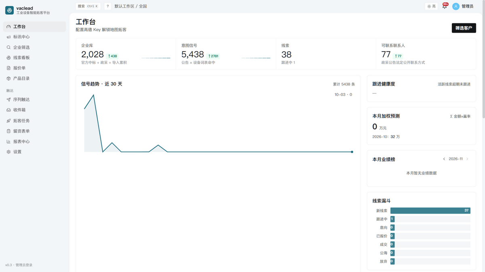

**标讯中心**——全平台中标/采购信号流：多维筛选带命中计数，每条带金额与溯源证据句，一键订阅/转线索

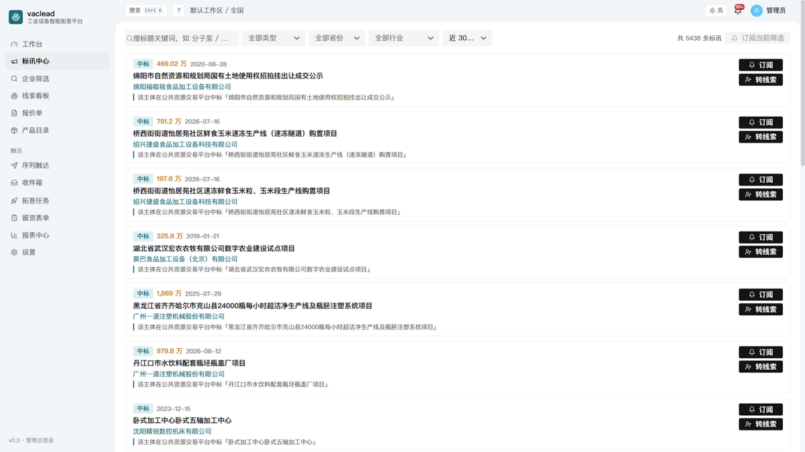

**企业情报页**——工商信息卡（法人/成立日期/完整度）+ ICP 四段可解释评分 + 采购关系图谱 + 联系人 + 备注/标签

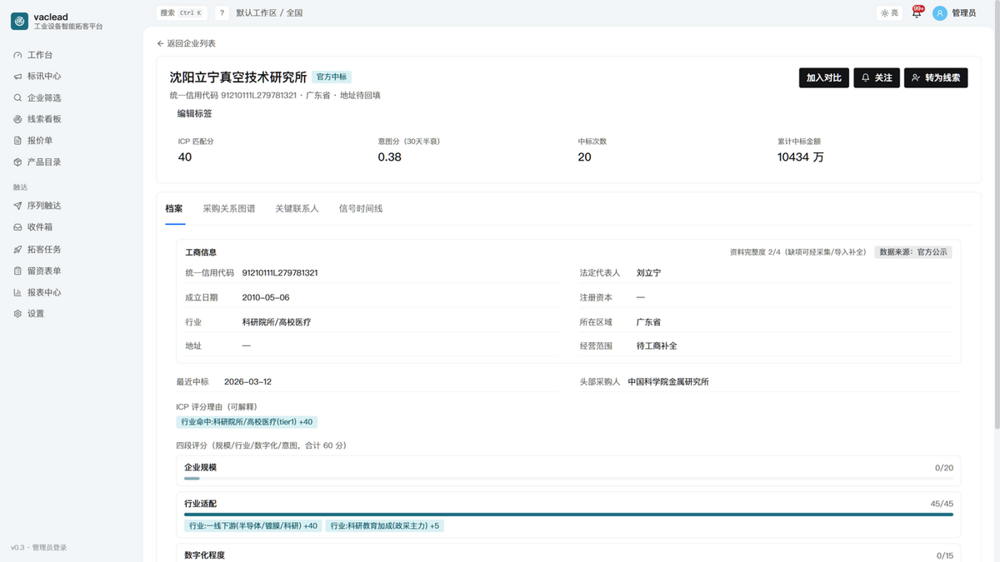

**企业筛选**——12 维组合筛选（行业/地区/资本/评分/信号/来源/成立年限/中标力/标签/联系方式/完整度）+ 快捷筛选 + 汇总条 + 批量操作

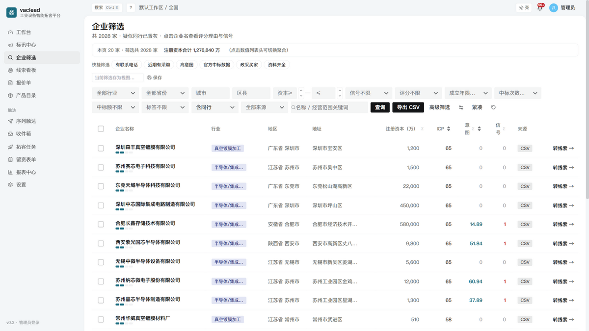

**线索看板**——拖拽转阶段（赢率自动更新）+ 日历视图 + 公海流转 + 批量领取

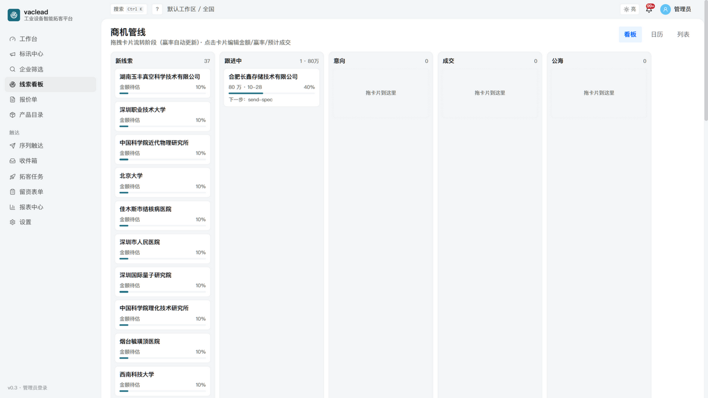

**报表中心**——经营周报（KPI 环比/漏斗/Top 标讯/来源转化对比）+ CSV 导出 + 每周一邮件摘要

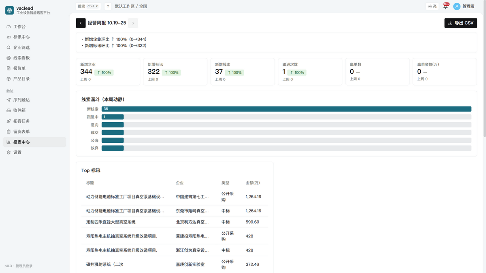

**企业对比**——最多 4 家横向对比，最优值高亮，链接可分享

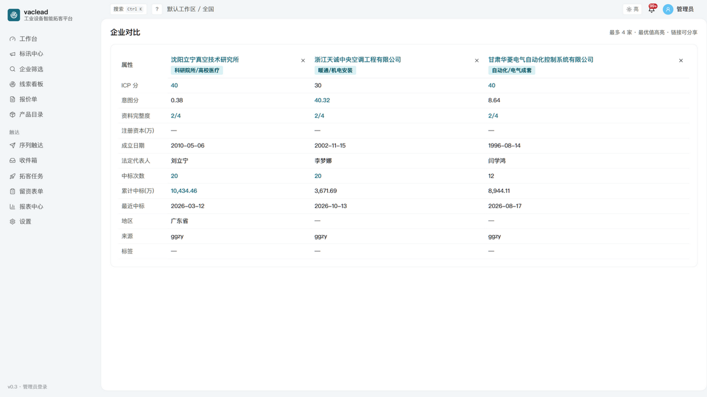

<details>
<summary>更多界面（登录 / 报价单 / 邮件触达 / 设置治理）</summary>

| | |
|---|---|
| 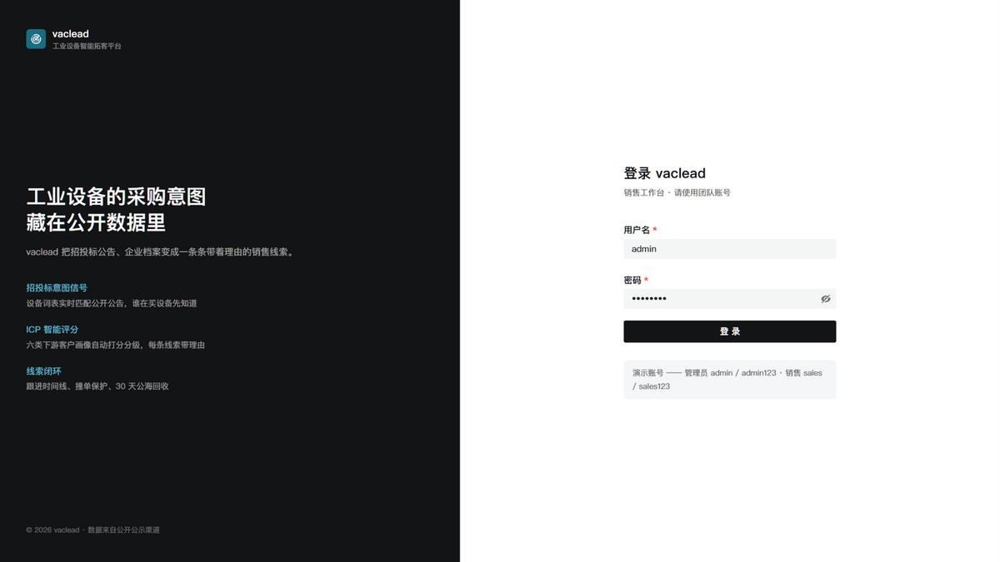 | 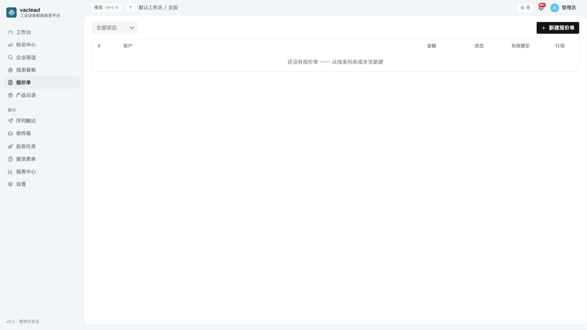 |
| 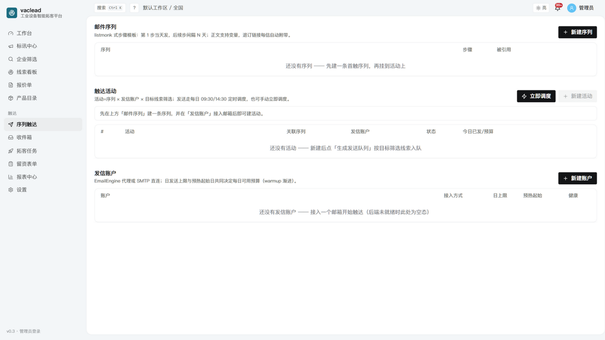 | 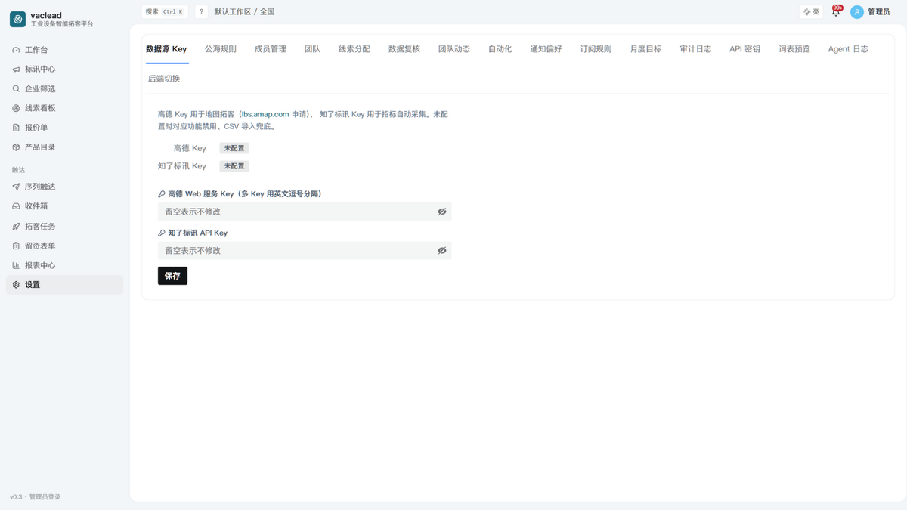 |

</details>

## 核心能力

| 域 | 能力 |
|---|---|
| **数据获取（免 Key）** | data.ggzy.gov.cn 官方中标 API 直采 + ccgp.gov.cn 政采公告全文检索；145 设备强词 × 20 买家行业（`config/industrial.yaml` 配置驱动）；采集韧性层（错误积分制/指数冷却，吸收 crawlee）；每日增量自动扩池 |
| **联系人解锁** | 政采公告详情页的**法定公开联系方式**（项目联系人/电话/邮箱/地址）自动回填——每条带公告溯源，验证态三档 |
| **信号引擎** | 强/弱词两级匹配；intent=Σ分×0.5^(Δ天/30) 半衰；ICP 四段可解释评分（规模/行业/数字化/意图，吸收 opengtm）+ 同行自动打标 |
| **标讯中心** | 三类信号流（中标/采购/政采公告）：类型/省份/行业/关键词/时间窗筛选带 facet 计数、金额自动提取、**一键订阅当前筛选**、一键转线索、官方原文直达 |
| **企业情报** | 工商信息卡（法人/成立日期/注册资本/资料完整度）、采购关系图谱（边宽=金额）、关键联系人（决策链标记）、备注与标签、四段评分理由 |
| **线索管线** | 拖拽看板（阶段赢率自动更新）+ 日历视图 + 公海规则（回收/领取上限/批量领取）+ **自动分配**（轮转/固定，吸收 EspoCRM）+ 团队与成员管理 + 过程监管 |
| **转化闭环** | 产品目录 + 报价单（状态机/打印视图）+ **邮件序列触达**（模板变量/预算链/回信匹配/退订，吸收 warmbly+listmonk）+ 留资表单 web-to-lead |
| **自动化** | 规则引擎（条件组→动作链+否则分支+dry-run 预览）+ 出站 **Webhooks**（HMAC 签名/指数退避/410 自停）+ 订阅通知（关键词/地区/筛选快照） |
| **分析** | 工作台 KPI 环比/信号趋势/漏斗/省份分布/**图表点击下钻**；加权管道预测（对照月度目标）；阶段转化率（audit 重放）；来源 ROI；跟进健康度；经营周报+CSV |
| **检索** | Meilisearch 投影（SQLite 真源双路，毫秒组合筛选+分面）；高级筛选构建器（AND/OR）；视图快照/URL 同步可分享；键盘快捷键（? 帮助 / g+数字导航 / Ctrl+K 命令面板） |
| **企业级** | 单进程部署（FastAPI 托管静态导出）、JWT+API Key 双通道、登录限流、审计日志（字段级 diff）、数据查重复核、团队 RBAC、每日备份/增量/画像调度（防呆+全任务水位）、229 pytest + 6 E2E |

## 快速开始

```bash
# 后端（Python 3.11+）
cd backend && pip install -r requirements.txt
python -m uvicorn app.main:app --host 127.0.0.1 --port 8000

# 前端构建（Node 18+）
cd frontend && npm install && npx next build   # 产物 out/ 由后端托管

# 浏览器打开 http://127.0.0.1:8000 （admin/admin123）
```

可选增强（**全部可选，缺省即降级，不影响主功能**）：Meilisearch（检索加速）、高德 Key（POI 地图拓客）、EmailEngine 或任意 SMTP（邮件触达发送通道）。

## 首次跑数据

登录后 → **拓客任务** → 「官方数据采集（免 Key）」→ 选关键词 → 开始采集（ggzy 中标数据 + ccgp 政采公告两通道）。之后全自动：

- 每日 03:30 自动增量采集（行业词表自动扩池）
- 04:08 自动回填新公告的联系人电话/邮箱
- 04:00 中标画像刷新、04:06 订阅规则匹配、04:10 SQLite 备份（滚动 7 份）
- 周一 08:30 上周经营周报邮件推送

## 技术栈

FastAPI + SQLAlchemy 2 + SQLite(WAL+FTS5) + Meilisearch(可选) ｜ Next.js 14 + Semi Design + Tailwind ｜ APScheduler（签名防呆统一注册）｜ Playwright E2E ｜ 229 pytest + 6 E2E

## 文档

- [docs/DATA_ACQUISITION.md](docs/DATA_ACQUISITION.md) — 数据获取工程学（合规边界/限流实测/接口契约/数据源全景）
- [docs/OPERATIONS.md](docs/OPERATIONS.md) — 运维手册（部署/定时任务/备份/Schema 变更登记）
- [docs/WORKLOG.md](docs/WORKLOG.md) — 44 轮开发日志（每轮含踩坑与经验）
- [docs/COLLABORATION.md](docs/COLLABORATION.md) — 多 Agent 协作协议（认领制/门禁/文件纪律）
- [docs/SPEC-J.md](docs/SPEC-J.md) 等 — 各功能轮契约（DDL 级表结构/接口/DoD）

## 合规红线

只采官方主动公开的数据；固定 UA + 限速 + 指数冷却；不绕验证码不破解 WAF；不爬登录后的商业产品；联系人全部带公告溯源。详见 DATA_ACQUISITION.md。

## License

MIT
